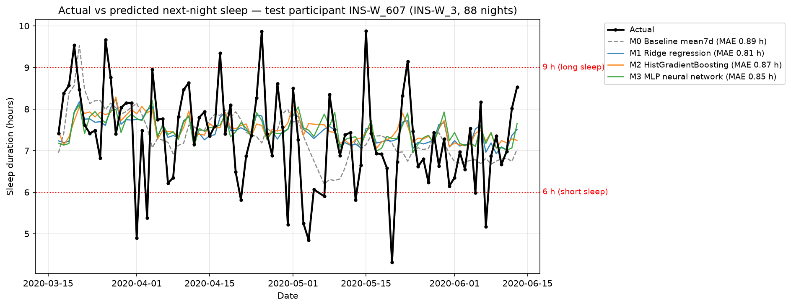
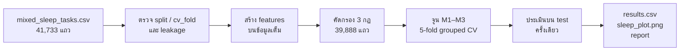

# 😴 Sleep Prediction — ทำนายชั่วโมงการนอนคืนถัดไปจาก Wearable

ทำนาย **จำนวนชั่วโมงการนอนของคืนถัดไป** (`sleep_hours_next`) ตั้งแต่ช่วงเย็น จากข้อมูล Fitbit ของผู้เข้าร่วม 733 คน (41,733 วัน)
ในชุดข้อมูล **Mixed Sleep** ซึ่งรวม 2 การศึกษา คือ **GLOBEM** (นักศึกษามหาวิทยาลัยในสหรัฐฯ ปี 2018–2021) และ **LifeSnaps** (ผู้ใหญ่ในยุโรป ปี 2021–2022)

> [!NOTE]
> โครงงาน ML กลุ่มละ 2 คน โจทย์ฉบับเต็มอยู่ใน [`Sleep_project_brief.pdf`](Sleep_project_brief.pdf)
> README นี้ใช้คุมขอบเขตงาน ถ้าขัดกับ PDF ให้ยึด PDF เป็นหลัก

> [!WARNING]
> **repo นี้ต้องเป็น private เท่านั้น** เพราะมีไฟล์ข้อมูลผู้เข้าร่วม (`*.csv`) อยู่ด้วย
> ห้ามเปลี่ยนเป็น public ห้ามนำข้อมูลไปเผยแพร่ต่อ (Kaggle, shared drive, เครื่องมือแชต) และห้ามพยายามระบุตัวตนผู้เข้าร่วม (ตามข้อกำหนดใน brief)

---

## 📑 สารบัญ

- [ผลลัพธ์โดยสรุป](#-ผลลัพธ์โดยสรุป)
- [สถานะงาน](#-สถานะงาน)
- [วิธีรัน](#️-วิธีรัน)
- [โครงสร้างไฟล์](#-โครงสร้างไฟล์)
- [ข้อมูล](#-ข้อมูล)
- [ขั้นตอนการทำงาน](#-ขั้นตอนการทำงาน)
- [ข้อกำหนดจาก brief](#-ข้อกำหนดจาก-brief)
- [เกณฑ์คะแนน](#-เกณฑ์คะแนน)
- [ข้อจำกัดและข้อห้าม](#️-ข้อจำกัดและข้อห้าม)
- [แหล่งอ้างอิง](#-แหล่งอ้างอิง)

---

## 📊 ผลลัพธ์โดยสรุป

ผลบน test set (8,038 แถว, 143 คน) จาก [`results.csv`](results.csv)

| Model | คำอธิบาย | MAE ↓ | RMSE ↓ | R² ↑ | Pearson r ↑ | Macro F1 ↑ | MAE GLOBEM | MAE LifeSnaps |
|:--|:--|--:|--:|--:|--:|--:|--:|--:|
| M0 | Baseline `mean7d` | 1.192 | 1.606 | 0.013 | 0.335 | **0.433** | 1.214 | 0.942 |
| M1 | Ridge regression | 1.099 | 1.455 | 0.190 | 0.436 | 0.377 | 1.113 | 0.937 |
| **M2** | **HistGradientBoosting** | **1.093** | **1.451** | **0.195** | **0.442** | 0.382 | **1.107** | **0.932** |
| M3 | MLP neural network | 1.101 | 1.461 | 0.184 | 0.433 | 0.394 | 1.114 | 0.950 |

- **M2 ดีที่สุด** ลด MAE จาก M0 ได้ **8.3%** แบบรวม, **8.8%** สำหรับ GLOBEM และ **1.1%** สำหรับ LifeSnaps
- ใกล้ค่าอ้างอิงใน brief (GLOBEM ≈ 1.14, LifeSnaps ≈ 0.94 ชม.)
- **ข้อแลกเปลี่ยน:** โมเดล ML ลด MAE ได้ แต่ค่าทำนายถูกดึงเข้าหาค่าเฉลี่ย ทำให้ macro F1 และ recall ของคลาสนอนน้อย (0.20) ต่ำกว่า M0 (0.32)

<p align="center">
  
</p>

<details>
<summary><b>ข้อค้นพบหลัก</b> (คลิกเพื่อดู)</summary>

| หัวข้อ | ผล |
|:--|:--|
| Feature 3 อันดับแรก (permutation importance ของ M2) | 1) `sleep_person_mean_h` ค่าปกติระยะยาวของแต่ละคน · 2) `is_fri_sat_night` คืนวันศุกร์/เสาร์ · 3) `sleep_mean14d_h` ค่าเฉลี่ย 14 วัน |
| นอนน้อยเกิดซ้ำ | P(คืนถัดไป < 6 ชม. \| เมื่อคืน < 6) = 34.4% เทียบกับ 17.0% หลังคืนปกติ |
| พลาดมากที่สุด | คืนวันศุกร์ (MAE 1.29) · cohort INS-W_3 ช่วงล็อกดาวน์ (1.18) · คืนที่นอน > 9 ชม. (2.26) หรือ < 6 ชม. (1.75) |
| ผู้เข้าร่วมแบบใด | คนที่การนอนแกว่งมาก: corr(MAE รายคน, SD การนอน) = 0.98 |
| โบนัส Personalisation | ได้ผลน้อยมาก (MAE 1.0928 → 1.0914 ที่ k = 14) เพราะ features เทียบกับค่าปกติของแต่ละคนอยู่แล้ว |

รายละเอียดทั้งหมดอยู่ใน [`report.md`](report.md)

</details>

---

## ✅ สถานะงาน

| สิ่งที่ต้องส่ง | ไฟล์ | สถานะ |
|:--|:--|:--:|
| Notebook เดียวที่ Restart & Run All ได้ (`random_state=42`) | [`sleep_prediction.ipynb`](sleep_prediction.ipynb) | ✅ |
| ตารางผล 4 โมเดล | [`results.csv`](results.csv) | ✅ |
| กราฟการนอน 1 รูป | [`sleep_plot.png`](sleep_plot.png) | ✅ |
| Features 10 แถวที่ผู้สอนกำหนด | [`features_example.csv`](features_example.csv) | ⚠️ |
| รายงาน ≤ 5 หน้า ตอบ 4 คำถาม | [`report.md`](report.md) | 🟡 |
| งานโบนัส (Personalisation) | [`bonus_personalisation.png`](bonus_personalisation.png) | ✅ |
| นำเสนอ 10 นาที + ถามตอบ 5 นาที | – | ⬜ |

**งานที่เหลือ**

- [ ] **`features_example.csv`:** ตอนนี้เป็น 10 แถวสุ่มชั่วคราว ให้ใส่ `participant_id` + `date` ที่ผู้สอนกำหนดใน `EXAMPLE_KEYS` (notebook ส่วน 2.7) แล้วรันใหม่
- [ ] **รายงาน:** แปลง `report.md` เป็น PDF ไม่เกิน 5 หน้า และใส่ชื่อสมาชิก
- [ ] **สไลด์นำเสนอ** 10 นาที

---

## ▶️ วิธีรัน

**ความต้องการ:** Python 3.10+ และไลบรารีต่อไปนี้

```bash
pip install pandas numpy scikit-learn matplotlib jupyter
```

**ขั้นตอน**

1. วางไฟล์ข้อมูล `mixed_sleep_tasks.csv` ไว้ที่ `data/processed/` หรือที่โฟลเดอร์หลักของโปรเจกต์ (notebook หาได้ทั้งสองที่)
2. เปิด `sleep_prediction.ipynb` แล้วเลือก **Restart & Run All** (ใช้เวลาประมาณ 75 วินาที)
3. ไฟล์ผลลัพธ์จะถูกเขียนลงโฟลเดอร์เดียวกับ notebook

> [!TIP]
> ไฟล์ข้อมูลไม่ได้อยู่ใน repo นี้ ขอได้จากผู้สอนของรายวิชา

---

## 📁 โครงสร้างไฟล์

```text
Sleep-prediction/
├── README.md                    # ไฟล์นี้
├── Sleep_project_brief.pdf      # โจทย์
├── sleep_prediction.ipynb       # notebook หลัก (ส่วนที่ 1–6)
├── report.md                    # ร่างรายงาน ตอบ 4 คำถาม
│
├── results.csv                  # ผล 4 โมเดลบน test (ไฟล์ส่งงาน)
├── features_example.csv         # features 10 แถว (ไฟล์ส่งงาน)
├── sleep_plot.png               # กราฟจริงเทียบค่าทำนาย (ไฟล์ส่งงาน)
├── filter_counts.csv            # จำนวนแถวหลังคัดกรองแต่ละกฎ
├── bonus_personalisation.png    # กราฟงานโบนัส
│
│   ── ข้อมูลตั้งต้น (ห้ามเผยแพร่) ──
├── mixed_sleep_tasks.csv        # ข้อมูลหลัก
├── lifesnaps_tasks.csv          # LifeSnaps คอลัมน์เต็ม (ไม่ได้ใช้)
├── lifesnaps_splits.csv
├── lifesnaps_feature_list.csv
└── pooling_results.csv          # ผลอ้างอิง
```

**ส่วนต่าง ๆ ใน notebook**

| ส่วน | เนื้อหา |
|:--:|:--|
| 1 | โหลดข้อมูล · ตรวจไฟล์ประกอบ · ตรวจ split/cv_fold · ยืนยัน leakage · คัดกรอง 3 กฎ |
| 2 | สร้าง 39 features · ทดสอบ leakage 2 แบบ · `features_example.csv` |
| 3 | M0–M3 · จูนด้วย 5-fold grouped CV · CV MAE แยกแหล่ง |
| 4 | ประเมินบน test · confusion matrix · feature importance · error analysis |
| 5 | `results.csv` · `sleep_plot.png` · ตรวจไฟล์ส่งงาน |
| 6 | งานโบนัส Personalisation |

---

## 🗂 ข้อมูล

### แหล่งข้อมูล

| แหล่งข้อมูล | กลุ่มตัวอย่าง | ช่วงเวลา | จำนวนคน | จำนวนคืน |
|:--|:--|:--|--:|--:|
| GLOBEM INS-W_1 | นักศึกษามหาวิทยาลัย (US) | เม.ย.–ก.ค. 2018 | 137 | 7,276 |
| GLOBEM INS-W_2 | นักศึกษามหาวิทยาลัย (US) | มี.ค.–มิ.ย. 2019 | 210 | 10,850 |
| GLOBEM INS-W_3 | นักศึกษามหาวิทยาลัย (US) | มี.ค.–มิ.ย. **2020 (ล็อกดาวน์)** | 131 | 7,907 |
| GLOBEM INS-W_4 | นักศึกษามหาวิทยาลัย (US) | มี.ค.–ก.ค. 2021 | 190 | 12,259 |
| LifeSnaps | ผู้ใหญ่ในยุโรป (Fitbit Sense) | พ.ค. 2021–ม.ค. 2022 | 65 | 3,441 |

### ไฟล์ข้อมูล

| ไฟล์ | ขนาด | การใช้งาน |
|:--|:--|:--|
| `mixed_sleep_tasks.csv` | 41,733 × 21 | ✅ **ข้อมูลหลัก ใช้ไฟล์เดียวนี้** |
| `lifesnaps_tasks.csv` | 3,449 × 74 | ❌ ไม่ใช้ (ดูเหตุผลด้านล่าง) |
| `lifesnaps_splits.csv` | 66 คน | ตรวจแล้ว split/cv_fold ตรงกับไฟล์หลัก 100% |
| `lifesnaps_feature_list.csv` | 67 แถว | รายชื่อคอลัมน์ LifeSnaps และ % ค่าว่าง |
| `pooling_results.csv` | 16 แถว | ใช้เทียบความสมเหตุสมผลเท่านั้น (เป็นที่มาของค่าอ้างอิง 1.14 / 0.94) |

<details>
<summary><b>ทำไมไม่ใช้ <code>lifesnaps_tasks.csv</code></b></summary>

- 3,441 แถวที่ซ้ำกับไฟล์หลักมีค่า **ตรงกัน 100%** ส่วน 8 แถวที่เกินมามี target ว่างทั้งหมด
- คอลัมน์ที่เพิ่มมา 56 ตัว **GLOBEM ไม่มี** (~92% ของแถว) brief ระบุว่ารวม 2 แหล่ง "ด้วย features ที่มีร่วมกัน"
- มีคอลัมน์ข้อมูลอนาคต (`stress_score_next`) และ 23 คอลัมน์ที่ว่าง ≥ 50%

ตรวจซ้ำได้ใน notebook ส่วน 1.1b

</details>

### คอลัมน์ใน `mixed_sleep_tasks.csv`

1 แถว = ผู้เข้าร่วม 1 คน × วันที่ t · features = สิ่งที่รู้ได้ภายในเย็นวันที่ t · target = การนอนของคืนที่เริ่มเย็นวันนั้น

| กลุ่ม | คอลัมน์ | ใช้เป็น feature |
|:--|:--|:--:|
| ระบุตัว / การแบ่งข้อมูล | `participant_id`, `source`, `cohort`, `date`, `split`, `cv_fold` | ❌ |
| Target | `sleep_hours_next` (ชม.) | 🎯 |
| ข้อมูลอนาคต | `sleep_efficiency_next` | ❌ |
| การนอนเมื่อคืน | `lastnight_minutesAsleep`, `lastnight_time_in_bed_min`, `lastnight_minutesAwake`, `lastnight_minutesAfterWakeup`, `lastnight_sleep_efficiency` | ✅ |
| ไม่มีประโยชน์ | `lastnight_minutesToFallAsleep` (เกือบทั้งหมดเป็น 0) | ➖ |
| กิจกรรม | `steps` | ✅ |
| ค่าเฉลี่ย 7 วัน (รวมวัน t) | `mean7d_steps`, `mean7d_minutesAsleep`, `mean7d_sleep_efficiency` | ✅ |
| ปฏิทิน / แหล่ง | `day_of_week` (0 = จันทร์), `is_weekend` (เสาร์–อาทิตย์), `is_globem` | ✅ |

### ข้อควรรู้เกี่ยวกับข้อมูล

| ประเด็น | รายละเอียด |
|:--|:--|
| ความไม่สมดุลของแหล่ง | GLOBEM ≈ 92% ของแถว MAE รวมจึงถูก GLOBEM ครอบงำ ต้อง **รายงานแยกแหล่งเสมอ** |
| Domain shift | LifeSnaps ตื่นกลางดึก ~58 นาที/คืน (GLOBEM ~26) และนอนน้อยกว่า ~30 นาที |
| ความแปรปรวน | SD ภายในคนเดียวกัน (≈ 1.39 ชม.) มากกว่า SD ระหว่างคน (≈ 0.79 ชม.) |
| วันหยุด | คืนวันศุกร์–เสาร์นอนนานกว่าคืนอื่น ~0.4 ชม. |
| ล็อกดาวน์ (INS-W_3) | ก้าวลดจาก ~10,900 เหลือ ~4,600 ก้าว/วัน |
| ค่าว่าง | NaN = ไม่ได้สวมนาฬิกา หรือคืนไม่ถูกต้อง (บนเตียง < 3 ชม. หรือหลับ > 15 ชม.) |
| ⚠️ Leakage | `sleep_hours_next[t] × 60 == lastnight_minutesAsleep[t+1]` ในวันติดกัน **ห้ามใช้ข้อมูลวัน t+1** |

---

## 🔬 ขั้นตอนการทำงาน



### 1. คัดกรองข้อมูล

| ขั้น | train GLOBEM | train LifeSnaps | test GLOBEM | test LifeSnaps | รวม | ตัดออก |
|:--|--:|--:|--:|--:|--:|--:|
| ข้อมูลตั้งต้น | 30,564 | 2,785 | 7,728 | 656 | 41,733 | – |
| R1: `sleep_hours_next` ว่าง | 30,564 | 2,785 | 7,728 | 656 | 41,733 | 0 |
| R2: ไม่มีประวัติการนอน | 29,818 | 2,661 | 7,549 | 633 | 40,661 | 1,072 |
| R3: `steps` ว่างหรือ = 0 | 29,208 | 2,642 | 7,405 | 633 | **39,888** | 773 |

เหลือ 95.6% · train 31,850 แถว (581 คน) · test 8,038 แถว (143 คน) · ไม่มีผู้เข้าร่วมซ้ำระหว่าง train และ test

### 2. Features (39 ตัว)

| กลุ่ม | ตัวอย่าง |
|:--|:--|
| ประวัติการนอน | `sleep_last_h`, `sleep_lag1_h`, `sleep_mean3d_h`, `sleep_mean7d_h`, `sleep_mean14d_h`, `sleep_std7d_h`, `short_nights_7d` |
| คุณภาพการนอนเมื่อคืน | `time_in_bed_h`, `awake_min`, `efficiency_last` |
| เทียบกับค่าปกติของแต่ละคน | `sleep_person_mean_h`, `sleep_dev_last_h`, `sleep_z_last`, `awake_dev_min` |
| กิจกรรม | `steps_k`, `steps_mean7d_k`, `steps_dev_7d_k`, `steps_ratio_person` |
| ปฏิทิน / แหล่ง | `is_fri_sat_night`, `dow_0`–`dow_6`, `is_globem` |

**หลักการกัน leakage**

- ใช้ข้อมูลของคนเดียวกัน **วันที่ ≤ t** เท่านั้น ไม่มี `shift(-k)`
- lag / rolling ใช้ **วันตามปฏิทิน** (`asfreq("D")`) เพราะมี 3,327 แถวที่ห่างจากแถวก่อนหน้าเกิน 1 วัน
- ค่าปกติของแต่ละคนใช้ expanding mean (ข้อมูลจนถึงวัน t)
- imputer / scaler อยู่ใน Pipeline จึง fit เฉพาะบน fold ที่ใช้ train
- **ทดสอบอัตโนมัติ 2 แบบ:** ตัดข้อมูลหลังวัน t ทิ้งแล้วคำนวณใหม่ ได้ค่าเท่าเดิม 300/300 แถว และใส่ค่าขยะในข้อมูลอนาคต features ไม่เปลี่ยน

### 3. โมเดล

| Model | เหตุผลที่เลือก | Hyperparameter ที่ได้ |
|:--|:--|:--|
| M0 Baseline | บังคับตาม brief: `mean7d_minutesAsleep / 60` (557 แถวใน test ที่ mean7d ว่างใช้ `lastnight / 60` แทน) | – |
| M1 Ridge | noise สูงและ features สัมพันธ์กันสูง L2 ช่วยลด variance และตีความได้ | `alpha = 100` |
| M2 HistGradientBoosting | รับ NaN ได้เอง จับความสัมพันธ์ไม่เชิงเส้นได้ ใช้ loss ตรงกับ MAE | `loss = absolute_error`, `max_leaf_nodes = 31`, `min_samples_leaf = 200` |
| M3 MLP | ตระกูลต่างจาก M1/M2 ใช้ early stopping และ L2 | `hidden = (32,)`, `alpha = 1.0` |

**Metric เสริม:** recall ของคลาสนอนน้อย (< 6 ชม.) เพราะแอปมีไว้เตือนก่อนคืนที่จะนอนน้อย การพลาดคืนนอนน้อยจึงแพงกว่าการเตือนเกิน

---

## 📋 ข้อกำหนดจาก brief

<details>
<summary><b>กฎบังคับ</b></summary>

| # | กฎ | สถานะ |
|:--:|:--|:--:|
| 1 | Target: `sleep_hours_next` (regression) งานเดียว แปลงเป็น 3 คลาส (< 6, 6–9, > 9) เพื่อทำ confusion matrix และ F1 | ✅ |
| 2 | ใช้ `split` ที่ให้มา ห้ามแบ่งใหม่ตามแถว | ✅ |
| 3 | จูน hyperparameter ด้วย 5-fold grouped CV จาก `cv_fold` บน train เท่านั้น | ✅ |
| 4 | ใช้ test set ครั้งเดียว ตอนท้ายสุด | ✅ |
| 5 | Feature คำนวณจากข้อมูลคนเดียวกัน วันที่ ≤ t (เรียงตาม date ภายใน participant_id) | ✅ |
| 6 | คัดกรอง 3 กฎ และรายงานจำนวนแถวหลังแต่ละกฎ แยก train/test และ GLOBEM/LifeSnaps | ✅ |
| 7 | ห้ามใช้ `sleep_efficiency_next`, `participant_id`, `split`, `cv_fold` และข้อมูลวัน t+1 | ✅ |
| 8 | ห้าม impute target | ✅ |
| 9 | ใช้เฉพาะ pandas, numpy, scikit-learn และ `random_state=42` | ✅ |

</details>

<details>
<summary><b>ตัวชี้วัด (บน test set)</b></summary>

- **MAE** (ชม.) ตัวชี้วัดหลัก รายงานทั้งแบบรวมและแยก GLOBEM / LifeSnaps
- RMSE, R² และ Pearson r
- Confusion matrix และ macro F1 ของ 3 คลาส จากค่าที่ทำนายแปลงเป็นคลาส
- Metric เสริม 1 ตัว (ไม่บังคับ) พร้อมเหตุผล

</details>

<details>
<summary><b>รูปแบบ <code>results.csv</code></b></summary>

```csv
MODEL,MODEL_DESC,MAE,RMSE,R2,PEARSON_R,MACRO_F1,MAE_GLOBEM,MAE_LIFESNAPS,N_TEST
M0,Baseline mean7d,...
M1,...
M2,...
M3,...
```

`N_TEST` = จำนวนแถวใน test set หลังคัดกรอง

</details>

<details>
<summary><b>รายงาน (≤ 5 หน้า) ต้องตอบ 4 คำถาม</b></summary>

1. หลังคัดกรองเหลือกี่แถว แต่ละกฎตัดออกไปเท่าไร
2. เลือก M1–M3 เป็นโมเดลอะไร เพราะอะไร ตัวไหนดีที่สุด ดีกว่า M0 กี่ % ทั้งแบบรวมและแยก GLOBEM / LifeSnaps
3. Feature 3 อันดับแรกคืออะไร สอดคล้องกับความรู้เรื่องการนอนอย่างไร (นอนชดเชย, วันหยุด, กิจกรรม)
4. โมเดลพลาดมากที่สุดในกรณีไหน (วันในสัปดาห์ / cohort / ผู้เข้าร่วมแบบใด) เพราะอะไร

ทุกคำตอบต้องอ้างตัวเลขจากผลของตัวเอง

</details>

<details>
<summary><b>งานโบนัส (เลือก 1 หัวข้อ)</b></summary>

| หัวข้อ | รายละเอียด | เลือก |
|:--|:--|:--:|
| Transfer learning | ประเมินเฉพาะ LifeSnaps: เทรนด้วย LifeSnaps อย่างเดียว เทียบกับรวม GLOBEM (naive pooling, `is_globem`, sample weighting) | |
| Distribution shift | เทรนด้วย INS-W_1 + INS-W_2 แล้วทดสอบแยก INS-W_3, INS-W_4, LifeSnaps | |
| **Personalisation** | ใช้ k คืนแรกของผู้เข้าร่วม test (k = 0, 3, 7, 14) ปรับ bias ด้วย `bias × k / (k + λ)` แล้วพล็อต MAE เทียบกับ k | ✅ |
| Uncertainty | quantile regression หรือ conformal prediction ให้ช่วงทำนาย 80% | |

</details>

---

## 🏆 เกณฑ์คะแนน

| หมวด | เกณฑ์ | คะแนน |
|:--|:--|--:|
| เตรียมข้อมูล | ใช้ split / cv_fold ตามกำหนด ไม่มีผู้เข้าร่วมซ้ำระหว่าง train และ test | 5 |
| เตรียมข้อมูล | label = `sleep_hours_next` ไม่ impute target และใช้ครบ 3 กฎ | 10 |
| เตรียมข้อมูล | รายงานจำนวนแถวหลังแต่ละกฎ | 5 |
| **Features** | **features ของแถวตัวอย่างตรงกับเฉลย และไม่ใช้ข้อมูลจากอนาคต** | **25** |
| โมเดล | รันครบทุกโมเดล และปรับ hyperparameter ด้วย grouped CV | 10 |
| โมเดล | อธิบายเหตุผลการเลือก M1–M3 (และ metric เสริม) | 5 |
| ผลลัพธ์ | `results.csv` ครบ | 10 |
| ผลลัพธ์ | MAE, RMSE, R² (รวม + แยกแหล่ง) และ confusion matrix | 10 |
| ผลลัพธ์ | กราฟ 1 รูป มีชื่อแกนและหน่วย | 5 |
| รายงาน | ตอบครบ 4 คำถาม ทุกคำตอบอ้างตัวเลขจากผลของตัวเอง | 15 |
| | **รวม** | **100** |

---

## ⚠️ ข้อจำกัดและข้อห้าม

- ❌ ห้ามเปลี่ยน repo นี้เป็น public และห้ามอัปโหลดข้อมูลขึ้น Kaggle, shared drive หรือเครื่องมือแชตใด ๆ
- ❌ ห้ามพยายามระบุตัวตนผู้เข้าร่วม
- ❌ ห้ามแตะ test set ระหว่างพัฒนาหรือจูนโมเดล
- ข้อมูลการนอนเป็นค่าประมาณจาก Fitbit ไม่ใช่ผลตรวจการนอน (polysomnography)
- LifeSnaps มีเพียง 65 คน MAE แยกแหล่งจึงแกว่งได้มาก ควรรายงานคู่กับผล CV
- ผลงานนี้เพื่อการเรียนรู้เท่านั้น **ไม่ใช่การวินิจฉัยหรือคำแนะนำทางการแพทย์**

---

## 📚 แหล่งอ้างอิง

- Yfantidou, S. et al. LifeSnaps, a 4-month multi-modal dataset capturing unobtrusive snapshots of our lives in the wild. *Scientific Data* 9, 663 (2022).
- Xu, X. et al. GLOBEM Dataset: Multi-Year Datasets for Longitudinal Human Behavior Modeling Generalization. *NeurIPS 2022 Datasets and Benchmarks Track*.
